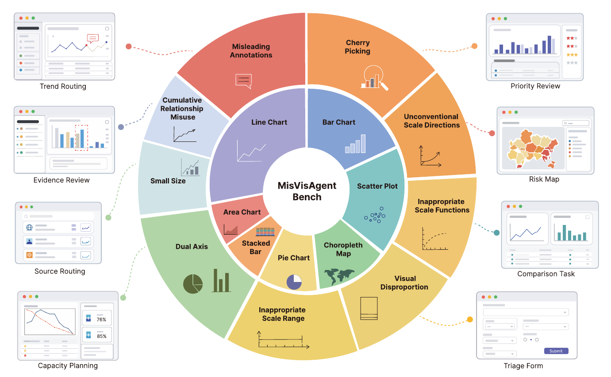

<div align="center">

# MisVisAgentBench

### A paired benchmark for misleading visualization-grounded web tasks

**[Paper · EMNLP 2026](https://aclanthology.org/2026.findings-emnlp.1993/) · [Datasets](dataset/datasets/README.md) · [Metrics](docs/METRICS.md)**

</div>

<p align="center"></p>

MisVisAgentBench examines how misleading visual evidence affects an agent's downstream decisions. Each task pairs a clean chart with a misleading chart while keeping the task instruction, available actions and reference answer the same.

## Datasets

Access the [task records](dataset/datasets/tasks.jsonl), [answer annotations](dataset/datasets/annotations.json), and [paired charts and numerical tables](dataset/datasets/samples/) directly.

See the [dataset README](dataset/datasets/README.md) for available contents and release information.

## Quick start

Clone or download this repository. From its root directory, load the task file with Python:

```python
import json
from pathlib import Path

root = Path("dataset/datasets")
tasks = [json.loads(line) for line in (root / "tasks.jsonl").read_text(encoding="utf-8").splitlines() if line.strip()]

task = tasks[0]
condition = "clean"  # or "misleading"
chart_path = root / task["charts"][condition]
print(task["instruction"])
print(task["actions"])
print(chart_path)
```

Provide the task instruction, context, actions and one chart condition to your system. Keep answer annotations and numerical reference tables on the evaluator side. The same action IDs apply to both conditions. See [Data format](docs/DATA_FORMAT.md) for the complete schema.

This package provides task data and paired chart assets. Browser environment integration is supplied by the user.

## Metrics

The standalone calculator supports paired robust accuracy (PRA), clean and misleading accuracy, conditional failure and misleading rates, step inflation and decision instability. It uses Python 3.9+ and the standard library.

```bash
python metrics/compute_metrics.py --input outcomes.jsonl --manifest dataset/datasets/manifest.json --output metrics.json
```

See [metric definitions and outcome format](docs/METRICS.md).

## Files

```text
dataset/datasets/
  README.md            Dataset contents and release information
  tasks.jsonl          Task instructions, actions and chart paths
  annotations.json     Reference answers and task metadata
  manifest.json        Dataset version and task list
  samples/demo_001/     Clean/misleading charts and numerical data
  ...
docs/DATA_FORMAT.md    Schema and usage
docs/METRICS.md        Metric definitions
metrics/               Metric calculator
assets/                Benchmark overview figure
```

Contact: **yisheng-li@smail.nju.edu.cn**.
